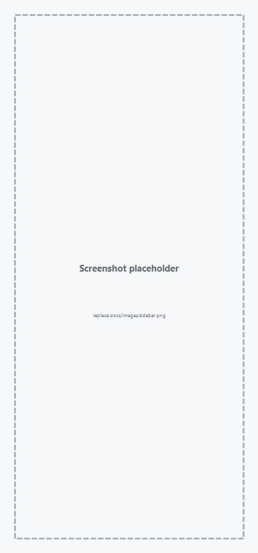
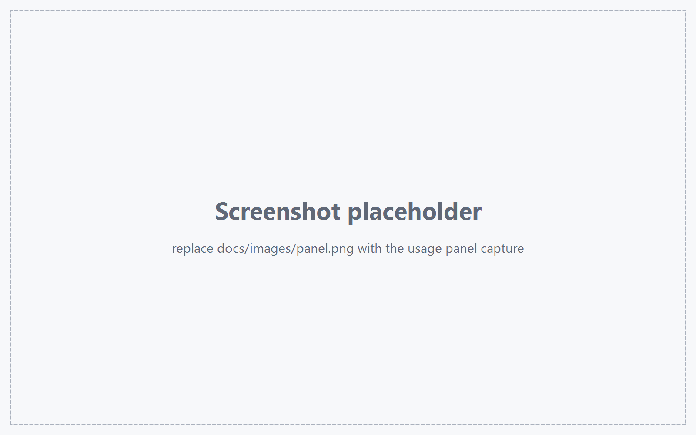

# dsh-apikey-usage

A DeepSeek Harness (DSH) Web UI plugin: a **left-sidebar entry** that opens a panel with **per-API-key daily token usage and estimated cost**.

Plain JavaScript, no dependencies, no build step.

---

## Features

- **Sidebar entry** (`sidebar.panellist`, order 20) and its matching `main` panel.
- **Per-key cards**: daily bar chart, daily table (date, calls, input, cache read, output, tokens, cost), per-model breakdown.
- **Summary tiles**: tokens today, cost today, last 7 days, last 30 days.
- **Ranges**: 7 / 30 / 90 days.
- **Key attribution** by provider route → credential name (`DEEPSEEK_API_KEY`, `KSYUN_API_KEY`, …).
- **Editable price table** (CNY per 1M tokens) that recomputes the whole history immediately.
- **Live**: ingests new `session/event` assistant messages; the panel refreshes every 60 s or on demand.
- **Local only**: no outbound requests, never reads secret values.

## Screenshots

> Both images are **placeholders**. Overwrite `docs/images/sidebar.png` and `docs/images/panel.png` with real captures and they appear here automatically — no README edit needed. Shot list: [docs/images/README.md](docs/images/README.md).

**Sidebar entry**



**Usage panel**



## Install

1. Open **Plugins** in the DSH sidebar.
2. **Add plugin** → paste the absolute path of this directory (or `github:<owner>/dsh-apikey-usage`).
3. **Install**, then reload the page; the 📊 icon appears in the sidebar.

Or ask the agent: “install the bundle at `C:\path\to\dsh-apikey-usage`” (it calls `plugin_manager` `install_bundle`).

Deployment, verification, upgrade, and troubleshooting details: **[docs/deployment.md](docs/deployment.md)**.

## How numbers are produced

- Tokens come from the profile's session logs (`assistant/message` → `usage`), so they are exact.
- The request records only the **provider route**, so the plugin maps provider → credential name:
  `keyLabels` in the config file → `llm-pi-ai` `providers.<id>.apiKeyEnv` → provider `nativeAuth.env` → built-in `deepseek*` mapping.
- Startup scans up to 180 days / 200 sessions, then accumulates live events.
- Cost is an **estimate**: `tokens / 1e6 × price`, matched by exact model → prefix → `*`.
- Default prices are DeepSeek's list prices; change them in the panel for third-party providers (e.g. ksyun).

## Configuration

`apikey-usage-config.json` next to the plugin sources (gitignored):

```json
{
  "prices": { "deepseek-v4.1-flash-1017": { "input": 2, "output": 8, "cacheRead": 0.5, "cacheWrite": 0 } },
  "keyLabels": { "deepseek-official": "DEEPSEEK_API_KEY" },
  "currency": "CNY"
}
```

See [`apikey-usage-config.example.json`](apikey-usage-config.example.json).

## Private routes

`POST /dsh-apikey-usage/api/{summary,scan,prices}` — JSON in/out, registered through `ctx.effect` and removed when the plugin unloads.

```bash
curl -s -X POST http://127.0.0.1:55342/dsh-apikey-usage/api/summary \
  -H 'Content-Type: application/json' -d '{"days":7}'
```

## Limitations

- Attribution is per **provider route**: one key configured as two providers shows two rows.
- Only sessions that still exist in this profile's logs are counted.
- Cost is estimated; third-party pricing must be configured manually.
- Needs the Web carrier services (`webServer`, `clientModules`); no panel in a headless CLI host.

## Development

Edit `index.js` / `client.js`, then toggle the bundle off/on in the Plugins page (or restart DSH) and reload the browser page. Syntax check: `node --check index.js && node --check client.js`.

The plugin row id is `apikey-usage`; it is also the sidebar `id` and the main-panel `key`.

## License

[MIT](LICENSE)
